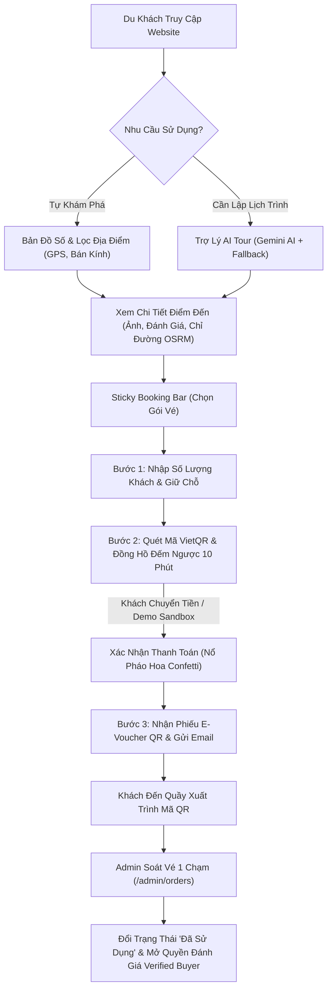

# 🌊 Nha Trang Staycation - Hệ Thống Bản Đồ Số & Đặt Vé Du Lịch Tương Tác

<p align="center">
  
  
  
  
  
  
</p>

> **Nha Trang Staycation** là nền tảng số hóa du lịch và ẩm thực tích hợp công nghệ bản đồ số (Leaflet & OSRM), trợ lý ảo lập kế hoạch thông minh (Google Gemini AI Tour) và phân hệ đặt vé vui chơi, tour đảo trực tuyến với mã quét E-Voucher QR tự động. Dự án được xây dựng theo kiến trúc MVC chuẩn mực, bảo mật cao và tối ưu trải nghiệm người dùng (*UI/UX Pro Max*).

---

## 📑 Mục Lục
1. [Điểm Nổi Bật Của Hệ Thống](#1-điểm-nổi-bật-của-hệ-thống)
2. [Ngăn Xếp Công Nghệ (Tech Stack)](#2-ngăn-xếp-công-nghệ-tech-stack)
3. [Cấu Trúc Thư Mục Dự Án](#3-cấu-trúc-thư-mục-dự-án)
4. [Hướng Dẫn Cài Đặt & Chạy Cục Bộ (Localhost)](#4-hướng-dẫn-cài-đặt--chạy-cục-bộ-localhost)
5. [Cấu Hình Biến Môi Trường (.env)](#5-cấu-hình-biến-môi-trường-env)
6. [Tài Khoản Thử Nghiệm Sẵn Có](#6-tài-khoản-thử-nghiệm-sẵn-có)
7. [Luồng Nghiệp Vụ Chính](#7-luồng-nghiệp-vụ-chính)
8. [Hướng Dẫn Chạy Thử Nghiệm Trên Điện Thoại & Đội Nhóm](#8-hướng-dẫn-chạy-thử-nghiệm-trên-điện-thoại--đội-nhóm)
9. [Nguyên Tắc Kỹ Thuật Bất Di Bất Dịch](#9-nguyên-tắc-kỹ-thuật-bất-di-bất-dịch)

---

## 1. Điểm Nổi Bật Của Hệ Thống

### 🤖 Trợ Lý Du Lịch Thông Minh (AI Tour Assistant)
- **Động cơ AI kép:** Kết nối trực tiếp **Google Gemini API** (`gemini-2.5-flash`), đồng thời tích hợp sẵn bộ xử lý **Fallback Engine** thông minh dựa trên cơ sở dữ liệu địa phương khi không có Internet hoặc chưa cấu hình API key.
- **Cá nhân hóa hội thoại:** Lưu trữ lịch sử chat (`ai_chat_messages`) theo tài khoản khách hàng để ghi nhớ ngữ cảnh hỏi - đáp qua các phiên làm việc.
- **Tương tác sâu với giỏ vé:** Thẻ gợi ý của AI hiển thị kèm nút `[ 🎟️ Đặt vé ngay ]` và cột tổng hợp vé tham quan trong tour.
- **Lưu lịch trình tùy biến:** Cho phép du khách lưu lại các kế hoạch du lịch yêu thích (`ai_saved_itineraries`) để mở xem lại bất kỳ lúc nào.
- **Widget AI Tour Nổi:** Nút tròn trợ lý thông minh bám góc màn hình, hỗ trợ thu nhỏ, mở to linh hoạt trên cả máy tính và điện thoại.

### 🗺️ Bản Đồ Số & Dẫn Đường Từng Chặng (Turn-by-Turn OSRM)
- **Bản đồ tương tác đa năng:** Sử dụng **Leaflet.js + OpenStreetMap** tích hợp gom nhóm địa điểm thông minh (**MarkerCluster**).
- **Chỉ đường OSRM nội bộ:** Tính toán lộ trình rẽ từng bước (Turn-by-Turn), tự động ước tính thời gian di chuyển và khoảng cách từ vị trí người dùng.
- **Định vị & Quét bán kính GPS:** Hỗ trợ quét nhanh các quán ăn, điểm du lịch lân cận theo bán kính **1km - 3km - 5km** kèm vòng tròn minh họa trực quan (`L.circle`).
- **Chuyển đổi phương tiện dẫn đường:** Tùy chọn chế độ *Xe máy / Ô tô* hoặc *Đi bộ ven biển Nha Trang*.

### 🎟️ Quy Trình Đặt Vé & Thanh Toán Tức Thì (Instant Checkout)
- **Quy trình 3 bước (Stepper UX):** 
  - *Bước 1: Chọn gói vé & Số lượng khách.*
  - *Bước 2: Quét mã VietQR NAPAS 247 & Giữ chỗ 10 phút.*
  - *Bước 3: Nhận ngay phiếu E-Voucher QR vào cổng tức thì.*
- **Sticky Booking Bar:** 
  - *Desktop:* Thẻ đặt vé gắn cố định ở thanh sidebar bên phải.
  - *Mobile:* Thanh bám đáy màn hình (*Bottom Sticky Bar*) tự động trượt lên khi người dùng cuộn xem nội dung.
- **Chế độ Thử Nghiệm (Demo Sandbox Mode):** Nút giả lập quét mã ngân hàng thành công phục vụ bảo vệ đồ án/học tập mà không tốn phí giao dịch thật.
- **Hiệu ứng Pháo hoa Chúc mừng (Canvas Confetti):** Bắn pháo hoa rực rỡ khi thanh toán thành công, kết hợp cơ chế **Auto-Polling (5 giây)** tự nhận diện khi Admin bấm duyệt ở tab khác.

### ⭐ Đánh Giá Minh Bạch & Gamification
- **Huy hiệu Khách hàng xác thực (Verified Buyer Badge):** Nhãn `✓ Đã mua vé & trải nghiệm` chỉ cấp cho những tài khoản đã thanh toán đơn vé tại địa điểm.
- **Bộ lọc đánh giá đa chiều:** Lọc theo số sao (5★ - 1★), lọc đánh giá có ảnh chụp thực tế, lọc khách đã mua vé kèm phân trang client-side mượt mà.

### 🛡️ Cổng Quản Trị Hệ Thống (Admin Portal)
- **Dashboard KPI thời gian thực:** Thống kê doanh thu hôm nay, tổng doanh thu, số vé đã phát hành, biểu đồ biến động doanh thu 7 ngày (Chart.js) và biểu đồ phân bổ trạng thái đơn.
- **Quản lý Địa điểm & Bộ sưu tập ảnh (Gallery):** Thêm/sửa địa điểm, tọa độ GPS, tải lên nhiều ảnh trải nghiệm chất lượng cao.
- **Gói Vé & Kiểm soát Quota theo ngày:** Thiết lập hạn mức tồn kho vé theo từng ngày cụ thể trên lịch, phòng chống quá tải (*Overbooking*).
- **Bàn Tra Cứu & Soát Vé QR:** Quét mã QR tại cổng hoặc tra cứu theo Mã đơn / SĐT, đổi vé 1 chạm chuyển trạng thái sang `Đã sử dụng`.
- **Quản lý Đánh giá & Báo cáo:** Kiểm duyệt hình ảnh/nhận xét người dùng, lọc doanh thu theo kỳ và xuất file dữ liệu **`.CSV`**.
- **Sổ Tay Vận Hành Tích Hợp (`/admin/guide`):** Tài liệu hướng dẫn sử dụng chi tiết từng phân hệ quản trị ngay trong sidebar.

---

## 2. Ngăn Xếp Công Nghệ (Tech Stack)

| Thành phần | Công nghệ / Thư viện | Vai trò |
| :--- | :--- | :--- |
| **Backend** | PHP 8.2 (Vanilla MVC) | Xử lý logic nghiệp vụ, điều hướng, bảo mật CSRF, Session |
| **Cơ sở dữ liệu** | MySQL 8.0 / MariaDB 10.4 | 12 bảng chuẩn hóa 3NF, Stored Generated Column, Foreign Keys |
| **AI Engine** | Google Gemini API (v1beta / REST) | Phân tích yêu cầu du khách, tạo lịch trình thông minh |
| **Bản đồ số** | Leaflet.js, OpenStreetMap, OSRM | Hiển thị tọa độ Nha Trang, dẫn đường Turn-by-Turn, vẽ bán kính GPS |
| **Thanh toán** | VietQR Standard, Napas 247 | Sinh mã QR thanh toán động kèm nội dung đơn hàng |
| **Hiệu ứng UX** | Canvas-Confetti, Animate.css | Hiệu ứng pháo hoa, viền sáng tương tác, loading state |
| **Frontend UI** | Bootstrap 5.3, Bootstrap Icons | Giao diện chuẩn Responsive, Glassmorphism, Theme đại dương |
| **Báo cáo đồ thị** | Chart.js | Vẽ biểu đồ đường doanh thu 7 ngày, biểu đồ tròn trạng thái |
| **Thư viện PHP** | `chillerlan/php-qrcode`, `phpmailer` | Sinh mã QR E-Voucher cục bộ, gửi email xác nhận vé |

---

## 3. Cấu Trúc Thư Mục Dự Án

```text
nhatrang-staycation/
├── .env.example                     # File mẫu biến môi trường
├── .env                             # Cấu hình môi trường máy cục bộ
├── .gitignore                       # Bỏ qua file nhạy cảm và thư mục vendor
├── composer.json                    # Cấu hình PSR-4 Autoloading và dependencies
├── README.md                        # Tài liệu hướng dẫn toàn diện
├── database/
│   ├── schema_vi.sql                # DDL khởi tạo cơ sở dữ liệu tiếng Việt
│   ├── init_db.php                  # Script tự động tạo bảng & import dữ liệu mẫu
│   ├── migrations/                  # Các file nâng cấp cấu trúc bảng (AI chat, Favorite...)
│   └── seeds/
│       ├── sample_data.sql          # 15 địa điểm thực tế, tài khoản & vé mẫu
│       └── gallery_seed.php         # Script nạp thư viện ảnh địa điểm
├── public/                          # Thư mục gốc Document Root (Công khai)
│   ├── index.php                    # Front Controller điều phối mọi request
│   ├── .htaccess                    # Rewrite URL sạch (Clean URL)
│   ├── assets/
│   │   ├── css/style.css            # Toàn bộ stylesheet tùy biến & animation
│   │   ├── js/main.js               # Logic bản đồ Leaflet, OSRM, tìm kiếm nhanh
│   │   └── images/                  # Icon, avatar, ảnh minh họa
│   └── uploads/                     # Thư mục lưu ảnh người dùng & mã QR
├── app/
│   ├── bootstrap.php                # Khởi động hệ thống, nạp .env & helper functions
│   ├── Router.php                   # Bộ định tuyến Clean URL Router
│   ├── Config/
│   │   └── Database.php             # Kết nối PDO Singleton an toàn
│   ├── Controllers/
│   │   ├── HomeController.php       # Trang chủ, trang Giới thiệu, Hướng dẫn
│   │   ├── LocationController.php   # Danh sách địa điểm, chi tiết, đánh giá
│   │   ├── AuthController.php       # Đăng nhập, đăng ký, đăng xuất
│   │   ├── BookingController.php    # Đặt vé, thanh toán VietQR, sinh E-Voucher
│   │   ├── AiTourController.php     # Xử lý đoạn chat AI, gợi ý tour, lưu lịch trình
│   │   ├── ProfileController.php    # Hồ sơ cá nhân, đổi mật khẩu, ví vé của tôi
│   │   └── Admin/
│   │       ├── DashboardController.php      # Thống kê KPI, biểu đồ Chart.js, hướng dẫn admin
│   │       ├── LocationManageController.php # CRUD địa điểm, gallery ảnh, GPS
│   │       ├── CategoryManageController.php # Quản lý danh mục
│   │       ├── TicketManageController.php   # Cấu hình gói vé, quota tồn kho theo ngày
│   │       ├── OrderManageController.php    # Tra cứu vé, soát vé quầy tiếp đón
│   │       ├── ReviewManageController.php   # Kiểm duyệt đánh giá cộng đồng
│   │       └── ReportController.php         # Báo cáo doanh số & xuất file CSV
│   ├── Models/                      # Tầng dữ liệu tương tác MySQL
│   ├── Services/
│   │   ├── AiTourService.php        # Dịch vụ Gemini API & fallback engine
│   │   └── BookingService.php       # Giao dịch đặt vé Atomic Update
│   └── Helpers/
│       ├── FormatHelper.php         # Định dạng tiền tệ, ngày tháng, sao đánh giá
│       ├── QrHelper.php             # Tạo ảnh mã QR E-Voucher bằng thư viện PHP
│       ├── MailHelper.php           # Gửi email thông báo vé bằng PHPMailer
│       └── WeatherHelper.php        # Tiện ích dự báo thời tiết Nha Trang
└── views/
    ├── layouts/
    │   ├── header.php, navbar.php, footer.php
    │   ├── admin_layout.php, admin_footer.php
    │   ├── ai_floating_widget.php   # Widget AI Tour nổi toàn trang
    │   └── 404.php
    ├── client/                      # Giao diện người dùng
    │   ├── home/ (index, about, guide)
    │   ├── locations/ (index, detail)
    │   ├── booking/ (_stepper, form, payment, voucher)
    │   ├── ai_tour/ (index)
    │   ├── profile/ (index)
    │   └── auth/ (login, register)
    └── admin/                       # Giao diện quản trị viên
        ├── dashboard/ (index, guide)
        ├── locations/ (index, form)
        ├── categories/ (index, form)
        ├── tickets/ (index)
        ├── orders/ (index)
        ├── reviews/ (index)
        └── reports/ (index)
```

---

## 4. Hướng Dẫn Cài Đặt & Chạy Cục Bộ (Localhost)

### Yêu Cầu Môi Trường
- **PHP:** Phiên bản $\ge$ 8.2 (Cần bật extensions: `pdo_mysql`, `curl`, `mbstring`, `openssl`).
- **MySQL / MariaDB:** Phiên bản $\ge$ 8.0 hoặc MariaDB 10.4+.
- **Composer:** Đã cài đặt trên máy.

### Bước 1: Sao chép mã nguồn & Cài đặt thư viện
```bash
git clone https://github.com/your-username/nhatrang-staycation.git
cd nhatrang-staycation
composer install
```

### Bước 2: Thiết lập file môi trường (.env)
Tạo file `.env` từ file mẫu:
```bash
cp .env.example .env
```
Mở file `.env` và kiểm tra cấu hình thông số kết nối Database:
```ini
DB_HOST=127.0.0.1
DB_PORT=3306
DB_DATABASE=nhatrang_staycation
DB_USERNAME=root
DB_PASSWORD=
APP_URL=http://localhost:8000
GEMINI_API_KEY=your_gemini_api_key_here
```

### Bước 3: Tự động khởi tạo Database & Dữ liệu mẫu
Khởi động dịch vụ MySQL (trên XAMPP/WAMP hoặc MySQL Service), sau đó chạy script khởi tạo:
```bash
php database/init_db.php
```
*Script sẽ tự động tạo cơ sở dữ liệu, khởi tạo toàn bộ 14 bảng quan hệ chuẩn 3NF, nạp 15 địa điểm thực tế, 23 ảnh gallery chất lượng cao và tự động đồng bộ mọi migration (AI Chat, Lịch trình đã lưu).*

### Bước 4: Khởi động máy chủ phát triển
Chạy máy chủ tích hợp của PHP trỏ vào thư mục `public`:
```bash
php -S localhost:8000 -t public
```

Truy cập website trên trình duyệt:  
👉 **[http://localhost:8000](http://localhost:8000)**

---

## 5. Cấu Hình Biến Môi Trường (.env)

| Biến | Ý nghĩa | Mặc định gợi ý |
| :--- | :--- | :--- |
| `APP_NAME` | Tên hệ thống hiển thị | `Nha Trang Staycation` |
| `APP_ENV` | Môi trường hoạt động | `local` |
| `APP_URL` | Đường dẫn gốc của website | `http://localhost:8000` |
| `DB_HOST` | Địa chỉ máy chủ CSDL | `127.0.0.1` |
| `DB_PORT` | Cổng MySQL | `3306` |
| `DB_DATABASE` | Tên cơ sở dữ liệu | `nhatrang_staycation` |
| `DB_USERNAME` | Tên người dùng database | `root` |
| `DB_PASSWORD` | Mật khẩu database | *(để trống nếu dùng XAMPP)* |
| `GEMINI_API_KEY` | Khóa API Google Gemini AI | *(Lấy miễn phí tại [Google AI Studio](https://aistudio.google.com))* |
| `MAIL_HOST` | Máy chủ gửi thư SMTP | `smtp.gmail.com` |
| `MAIL_USERNAME` | Tài khoản email gửi vé | `your-email@gmail.com` |
| `MAIL_PASSWORD` | Mật khẩu ứng dụng (App Password) | `xxxx xxxx xxxx xxxx` |

---

## 6. Tài Khoản Thử Nghiệm Sẵn Có

| Vai trò | Email đăng nhập | Mật khẩu | Quyền hạn & Phân hệ truy cập |
| :--- | :--- | :--- | :--- |
| **Quản Trị Viên (Admin)** | `admin@nhatrangtourism.vn` | `Admin@123` | Toàn quyền Quản trị, Soát vé QR quầy, Quản lý tồn kho, Báo cáo doanh số, Duyệt review |
| **Khách Hàng (VIP)** | `nguyenan@gmail.com` | `Khach@123` | Khám phá bản đồ, Đặt vé VietQR, Sử dụng AI Tour, Xem ví vé E-Voucher |
| **Khách Hàng 2** | `tranmai@gmail.com` | `Khach@123` | Tài khoản khách thử nghiệm viết đánh giá kèm ảnh |

---

## 7. Luồng Nghiệp Vụ Chính



---

## 8. Hướng Dẫn Chạy Thử Nghiệm Trên Điện Thoại & Đội Nhóm

### Cách A: Cùng mạng Wi-Fi (Chạy song song 1 Máy tính - 1 Điện thoại)
1. Trên máy tính, khởi động server mở cho toàn mạng LAN:
   ```bash
   php -S 0.0.0.0:8000 -t public
   ```
2. Mở PowerShell gõ `ipconfig` để lấy địa chỉ IPv4 của máy tính (ví dụ: `192.168.0.62`).
3. Trên điện thoại, kết nối cùng mạng Wi-Fi và truy cập trình duyệt:
   ```text
   http://192.168.0.62:8000
   ```
4. Thực hiện kịch bản: Máy tính mở trang Admin duyệt vé, điện thoại mở trang thanh toán VietQR & xem pháo hoa tự động chuyển trang!

### Cách B: Chia sẻ qua Cloudflare Tunnel (Cho cả nhóm test từ xa, hỗ trợ 4G/5G)
1. Tải file chạy chính thức [cloudflared-windows-amd64.exe](https://github.com/cloudflare/cloudflared/releases/latest/download/cloudflared-windows-amd64.exe), đổi tên thành `cloudflared.exe` và đặt vào thư mục dự án.
2. Mở Terminal và chạy lệnh:
   ```bash
   .\cloudflared.exe tunnel --url http://localhost:8000
   ```
3. Copy đường link có đuôi `https://xxx.trycloudflare.com` gửi vào nhóm. Tất cả thành viên có thể vào lướt web, chat AI và đặt vé trực tiếp.
4. Để tắt: Nhấn **`Ctrl + C`** tại Terminal.

---

## 9. Nguyên Tắc Kỹ Thuật Bất Di Bất Dịch

1. **Atomic Update chống Overbooking:** Số lượng tồn kho vé được cập nhật bằng lệnh SQL trực tiếp:  
   `UPDATE ton_kho_ve SET so_ve_con_lai = so_ve_con_lai - :qty WHERE id = :id AND so_ve_con_lai >= :qty`.
2. **Database Transaction toàn vẹn:** Mọi thao tác phát sinh đơn hàng, ghi nhận thanh toán và trừ tồn kho đều được bọc trong `beginTransaction()` và `commit()`. Nếu xảy ra sự cố sẽ tự động `rollBack()`.
3. **Giá vé tính toán tại Server:** Tuyệt đối không nhận giá tiền từ Frontend gửi lên. Cột `thanh_tien` trong bảng chi tiết đơn hàng là `STORED GENERATED COLUMN`.
4. **Bảo toàn dữ liệu (Soft Delete):** Đơn hàng và vé không bao giờ bị xóa vật lý (`DELETE`). Hệ thống chỉ cập nhật trường `ngay_xoa` và khóa ngoại bảng giao dịch luôn ở chế độ `RESTRICT`.
5. **Bảo mật phân quyền (Server-side RBAC):** Kiểm tra vai trò nghiêm ngặt qua `AuthMiddleware::checkAdmin()` và `AuthMiddleware::checkCustomer()`.
6. **Bảo mật mật khẩu:** Mã hóa mật khẩu người dùng bằng thuật toán chuẩn công nghiệp `password_hash($pass, PASSWORD_BCRYPT)`.

---

<p align="center">
  Phát triển với ❤️ dành cho Du lịch & Ẩm thực Nha Trang Staycation • 2026
</p>

## 8. Hướng Dẫn Chạy Thử Nghiệm Trên Điện Thoại & Đội Nhóm

### Cách A: Cùng mạng Wi-Fi (Chạy song song 1 Máy tính - 1 Điện thoại)
1. Trên máy tính, khởi động server mở cho toàn mạng LAN:
   ```bash
   php -S 0.0.0.0:8000 -t public
   ```
2. Mở PowerShell gõ `ipconfig` để lấy địa chỉ IPv4 của máy tính (ví dụ: `192.168.0.62`).
3. Trên điện thoại, kết nối cùng mạng Wi-Fi và truy cập trình duyệt:
   ```text
   http://192.168.0.62:8000
   ```
4. Thực hiện kịch bản: Máy tính mở trang Admin duyệt vé, điện thoại mở trang thanh toán VietQR & xem pháo hoa tự động chuyển trang!

### Cách B: Chia sẻ qua Cloudflare Tunnel (Cho cả nhóm test từ xa, hỗ trợ 4G/5G)
1. Tải file chạy chính thức [cloudflared-windows-amd64.exe](https://github.com/cloudflare/cloudflared/releases/latest/download/cloudflared-windows-amd64.exe), đổi tên thành `cloudflared.exe` và đặt vào thư mục dự án.
2. Mở Terminal và chạy lệnh:
   ```bash
   .\cloudflared.exe tunnel --url http://localhost:8000
   ```
3. Copy đường link có đuôi `https://xxx.trycloudflare.com` gửi vào nhóm. Tất cả thành viên có thể vào lướt web, chat AI và đặt vé trực tiếp.
4. Để tắt: Nhấn **`Ctrl + C`** tại Terminal.

---

## 9. Nguyên Tắc Kỹ Thuật Bất Di Bất Dịch

1. **Atomic Update chống Overbooking:** Số lượng tồn kho vé được cập nhật bằng lệnh SQL trực tiếp:  
   `UPDATE ton_kho_ve SET so_ve_con_lai = so_ve_con_lai - :qty WHERE id = :id AND so_ve_con_lai >= :qty`.
2. **Database Transaction toàn vẹn:** Mọi thao tác phát sinh đơn hàng, ghi nhận thanh toán và trừ tồn kho đều được bọc trong `beginTransaction()` và `commit()`. Nếu xảy ra sự cố sẽ tự động `rollBack()`.
3. **Giá vé tính toán tại Server:** Tuyệt đối không nhận giá tiền từ Frontend gửi lên. Cột `thanh_tien` trong bảng chi tiết đơn hàng là `STORED GENERATED COLUMN`.
4. **Bảo toàn dữ liệu (Soft Delete):** Đơn hàng và vé không bao giờ bị xóa vật lý (`DELETE`). Hệ thống chỉ cập nhật trường `ngay_xoa` và khóa ngoại bảng giao dịch luôn ở chế độ `RESTRICT`.
5. **Bảo mật phân quyền (Server-side RBAC):** Kiểm tra vai trò nghiêm ngặt qua `AuthMiddleware::checkAdmin()` và `AuthMiddleware::checkCustomer()`.
6. **Bảo mật mật khẩu:** Mã hóa mật khẩu người dùng bằng thuật toán chuẩn công nghiệp `password_hash($pass, PASSWORD_BCRYPT)`.

---

<p align="center">
  Phát triển với ❤️ dành cho Du lịch & Ẩm thực Nha Trang Staycation • 2026
</p>

